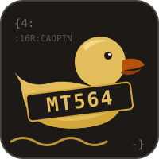

<p align="center">
  
</p>

<h1 align="center">mt564</h1>

<p align="center">
  A DuckDB extension for querying SWIFT MT564 corporate action notifications with SQL.
</p>

<p align="center">
  <a href="https://github.com/wdorninger/ddb_mt564-releases/releases"></a>
  
  
</p>

---

`mt564` reads batches of SWIFT FIN MT564 messages (Corporate Action Notification) directly into DuckDB.
The nested message structure (general information, underlying security, corporate action details, options
and their cash and securities movements) is exposed at a selectable grain, so each query returns one row
per message, per option or per movement, without cross-joining unrelated repeating blocks.

## Try it in the browser

Both extensions, `bberg` and `mt564`, can be tried without installing anything at
**[ddb-gcloud.web.app](https://ddb-gcloud.web.app/)** (DuckFin). The page runs DuckDB-Wasm in the browser with
the extensions preloaded: drop in your own `.out`, `.cax` or MT564 files and query them with SQL. Files are
processed locally in the browser and are not uploaded. The page also offers the native binaries for
download.

The web application is maintained in the [ddb_gcloud](https://github.com/wdorninger/ddb_gcloud) project.

## Using mt564 with the DuckDB JDBC driver

The extension can be loaded into any Java application that uses the
[DuckDB JDBC driver](https://duckdb.org/docs/stable/clients/java) in in-memory mode.

**1. Add the driver** (version 1.5.6.0 or newer):

```xml
<dependency>
  <groupId>org.duckdb</groupId>
  <artifactId>duckdb_jdbc</artifactId>
  <version>1.5.6.0</version>
</dependency>
```

**2. Download** the binary for your platform from the
[Releases](https://github.com/wdorninger/ddb_mt564-releases/releases) page, for example
`mt564.linux_amd64.duckdb_extension`.

**3. Allow unsigned extensions and load the file.**

> [!IMPORTANT]
> `mt564` is not signed with DuckDB's extension signing key. DuckDB refuses to load unsigned extensions
> unless signature checking is switched off with the `allow_unsigned_extensions` setting. This setting can
> only be given when the database is opened, so pass it in the connection properties. Running
> `SET allow_unsigned_extensions = true` on an open connection fails.

```java
import java.sql.*;
import java.util.Properties;

Properties props = new Properties();
props.setProperty("allow_unsigned_extensions", "true");     // switch off signature checking

try (Connection conn = DriverManager.getConnection("jdbc:duckdb:", props);   // in-memory database
     Statement stmt = conn.createStatement()) {

    stmt.execute("LOAD '/opt/duckdb/extensions/mt564.linux_amd64.duckdb_extension'");

    try (ResultSet rs = stmt.executeQuery(
            "SELECT ISIN, CAEV, CAOP FROM read_mt564('/data/swift/batch.txt', level = 'CAOPTN')")) {
        while (rs.next()) {
            System.out.println(rs.getString("ISIN") + "  " + rs.getString("CAEV") + "  " + rs.getString("CAOP"));
        }
    }
}
```

Without the property, `LOAD` fails with
`... could not be loaded because its signature is either missing or invalid and unsigned extensions are
disabled by configuration (allow_unsigned_extensions)`.

Each `jdbc:duckdb:` connection opens a separate in-memory database, and an extension is loaded per database.
Connections created with `DuckDBConnection.duplicate()` share the database and see the extension. When using
a connection pool, run the `LOAD` statement as the pool's connection-init SQL. See
[docs/jdbc.md](docs/jdbc.md) for details.

## Functions

| Function | Reads | Description |
|---|---|---|
| [`read_mt564(path, ...)`](docs/mt564.md) | MT564 batch files (`.txt`, `.fin`, `.mt564`, optionally `.gz`) | One row per message, or per repeating block selected with `level`. Message context columns on every row, one typed column per SWIFT qualifier. |

`read_mt564` accepts a file, a directory, a glob or a list of these. A quoted path ending in `.mt564` in the
`FROM` clause calls it automatically.

## Example

Using the sample file [`examples/notifications.txt`](examples/notifications.txt), which holds three
notifications: a cash dividend, a dividend with a scrip option and a merger.

One row per message:

```sql
LOAD 'mt564.linux_amd64.duckdb_extension';

SELECT ISIN, SECURITY_DESC, CAEV, CAMV, NUM_CAOPTN
FROM read_mt564('examples/notifications.txt');
```

| ISIN | SECURITY_DESC | CAEV | CAMV | NUM_CAOPTN |
|---|---|---|---|---:|
| XX0000000011 | QUACKWORKS INC COMMON STOCK | DVCA | MAND | 1 |
| XX0000000029 | MARSHLAND UTILITIES PLC ORD SHS | DVOP | CHOS | 2 |
| XX0000000037 | WADDLE SA ACTIONS ORD | MRGR | CHOS | 2 |

One row per election option:

```sql
SELECT ISIN, CAEV, CAON, CAOP, DFLT, NUM_CASHMOVE, NUM_SECMOVE
FROM read_mt564('examples/notifications.txt', level = 'CAOPTN');
```

| ISIN | CAEV | CAON | CAOP | DFLT | NUM_CASHMOVE | NUM_SECMOVE |
|---|---|---:|---|---|---:|---:|
| XX0000000011 | DVCA | 1 | CASH | Y | 1 | 0 |
| XX0000000029 | DVOP | 1 | CASH | Y | 1 | 0 |
| XX0000000029 | DVOP | 2 | SECU | N | 0 | 1 |
| XX0000000037 | MRGR | 1 | CASE | Y | 1 | 1 |
| XX0000000037 | MRGR | 2 | NOAC | N | 0 | 0 |

The [function reference](docs/mt564.md) walks through every `level` with this file.

## Downloads

| File | Platform |
|---|---|
| `mt564.linux_amd64.duckdb_extension` | Linux x86-64 (glibc 2.28 or newer) |
| `mt564.osx_arm64.duckdb_extension` | macOS on Apple silicon (macOS 11 or newer) |
| `mt564.osx_amd64.duckdb_extension` | macOS on Intel (macOS 11 or newer) |
| `mt564.windows_amd64.duckdb_extension` | Windows x86-64 |
| `mt564.duckdb_extension.wasm` | DuckDB-Wasm (`wasm_eh`), browser and Node.js |
| `SHA256SUMS` | SHA-256 checksums of the files above |

Verify a download with `sha256sum -c SHA256SUMS --ignore-missing`.

Keep the file name starting with `mt564.`. DuckDB derives the extension name from the part before the first
dot.

This repository publishes compiled binaries and documentation only. The source code is not public.

## Compatibility

`mt564` works with DuckDB 1.5.6 and newer, including 2.0.x. It is built against DuckDB's stable C extension
API (v1.5.6), so one binary loads into every later DuckDB release without a rebuild. Remote file systems
(`httpfs`, S3, GCS, Azure), secrets and caching are provided by the DuckDB instance that loads the extension.

## Other clients

All clients need unsigned extensions to be allowed before the database is opened.

| Client | How to allow unsigned extensions | Then |
|---|---|---|
| DuckDB CLI | `duckdb -unsigned` | `LOAD '/path/to/mt564.<platform>.duckdb_extension';` |
| Python | `duckdb.connect(config={"allow_unsigned_extensions": "true"})` | `con.execute("LOAD '...'")` |
| Java (JDBC) | `allow_unsigned_extensions=true` in the connection `Properties` | see [above](#using-mt564-with-the-duckdb-jdbc-driver) |
| DuckDB-Wasm | `db.open({ allowUnsignedExtensions: true })` | see [docs/wasm.md](docs/wasm.md) |

On macOS, Gatekeeper quarantines downloaded files. Clear the flag before loading:
`xattr -d com.apple.quarantine mt564.osx_arm64.duckdb_extension`.

## Documentation

| Page | Contents |
|---|---|
| [docs/mt564.md](docs/mt564.md) | `read_mt564`: message structure, `level` grains, output columns, options, examples, limitations |
| [docs/usage.md](docs/usage.md) | Inputs, remote storage, types, NULLs, parallelism, errors |
| [docs/jdbc.md](docs/jdbc.md) | Java integration: in-memory and file databases, connection pools, packaging the binary |
| [docs/wasm.md](docs/wasm.md) | Running the extension in DuckDB-Wasm |
| [ddb-gcloud.web.app](https://ddb-gcloud.web.app/) | Live DuckDB-Wasm demo with both extensions ([ddb_gcloud](https://github.com/wdorninger/ddb_gcloud)) |
| [examples/](examples/) | Sample MT564 batch used throughout the documentation |

## Sample data disclaimer

All sample files and examples in this repository contain fictitious test data created solely for
documentation purposes. Messages, BICs, references, ISINs, security names, account numbers, rates, amounts
and dates are invented and do not refer to any real institution, security, account or corporate action. Any
resemblance to actual entities or data is coincidental. No production SWIFT traffic is included.

## Trademarks

SWIFT is a trademark of S.W.I.F.T. SC. DuckDB is a trademark of the DuckDB Foundation. This project is
independent and is not affiliated with, sponsored by or endorsed by either organisation.

## Third-party notices

See [THIRD_PARTY_NOTICES.md](THIRD_PARTY_NOTICES.md).
